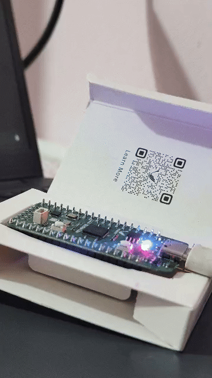

# Shrike Lite Bare-Metal RP2040 Blink

Bare-metal C firmware for the [Vicharak Shrike Lite](https://vicharak.in/) development board.
Blinks the onboard RP2040 user LED with zero external dependencies (no Pico SDK, no standard libraries, no HAL).



## Hardware

- **Board:** Vicharak Shrike Lite
- **MCU:** Raspberry Pi RP2040 (Dual-core ARM Cortex-M0+ @ 133 MHz, 264 KB SRAM)
- **FPGA:** Renesas ForgeFPGA SLG47910 (1,120 LUTs)
- **Flash:** Winbond W25Q16JV (2 MB QSPI NOR Flash)
- **LED Indicators:**
  - **Power Rail:** Red LED (3.3V supply indicator)
  - **RP2040 User LED:** Blue LED on GPIO 4 (toggled by this firmware)
  - **FPGA User LED:** Blue LED driven by Renesas ForgeFPGA logic

*Note: GPIO 25 is also toggled simultaneously for compatibility with standard Raspberry Pi Pico hardware.*

## Memory Map

| Region | Base Address | Size | Description |
|---|---|---|---|
| `BOOT2` | `0x10000000` | 256 B | Stage 2 bootloader (Synopsys SSI QSPI continuous read configuration) |
| `FLASH` | `0x10000100` | 2 MB | Cortex-M0+ vector table and runtime executable |
| `RAM` | `0x20000000` | 264 KB | Stack and data segments |
| `RESETS` | `0x4000C000` | - | Subsystem reset controller |
| `IO_BANK0` | `0x40014000` | - | GPIO function multiplexer |
| `SIO` | `0xD0000000` | - | Single-cycle I/O (atomic bit-level manipulation) |

## Register Reference

| Address | Register | Description |
|---|---|---|
| `0x4000C000` | `RESETS_RESET` | Clear bit 5 (`IO_BANK0`) and bit 8 (`PADS_BANK0`) to release reset |
| `0x4000C008` | `RESETS_RESET_DONE` | Poll until peripheral reset release completes |
| `0x40014024` | `GPIO4_CTRL` | Select Function 5 (SIO) for GPIO 4 (`FUNCSEL = 5`) |
| `0x400140CC` | `GPIO25_CTRL` | Select Function 5 (SIO) for GPIO 25 (`FUNCSEL = 5`) |
| `0xD0000024` | `SIO_GPIO_OE_SET` | Atomic output enable for target pins |
| `0xD000001C` | `SIO_GPIO_OUT_XOR` | Atomic single-cycle GPIO pin state inversion |

All addresses are verified against the RP2040 Datasheet (Sections 2.3.1, 2.14, and 2.19).

## Build

Prerequisites: GNU Arm Embedded Toolchain (`arm-none-eabi-gcc`) and Python 3.

```bash
make
```

Output:
- `blink.elf`: 604 bytes total text
- `blink.uf2`: 1,536 bytes (3 x 512-byte UF2 blocks)

## Flash

1. Hold the **BOOT** button on the Shrike Lite.
2. Connect USB-C. The RP2040 Boot ROM mounts as a USB mass storage drive named `RPI-RP2`.
3. Flash the binary:
   ```bash
   make flash
   ```
   Or manually:
   ```bash
   cp blink.uf2 /run/media/$USER/RPI-RP2/
   ```
4. The RP2040 Boot ROM writes the payload to QSPI flash and reboots into the firmware. The blue RP2040 LED on GPIO 4 blinks.

## Boot Sequence

1. **Boot ROM:** Microcode at `0x00000000` copies the first 256 bytes from external flash (`0x10000000`) into SRAM and validates an MSB-first CRC32 checksum.
2. **Boot2 (`boot2.S`):** Configures the Synopsys SSI controller into Quad Continuous Read mode (`0xEB`) for eXecute-In-Place (XIP), then returns to Boot ROM.
3. **Runtime Init (`crt0.S`):** Boot ROM sets the Main Stack Pointer (`_stack_top` at `0x20042000`) and branches to `_reset_handler` at `0x10000104`. `crt0.S` zeros `.bss` in SRAM, copies `.data` from Flash to SRAM, and branches to `main()`.
4. **Firmware (`main.c`):** Releases `IO_BANK0` and `PADS_BANK0` from reset, configures GPIO 4 and GPIO 25 to the SIO block, sets output direction, and toggles the pins via atomic single-cycle register writes.

## Demonstration Video

*Video link will be added upon publication.*
